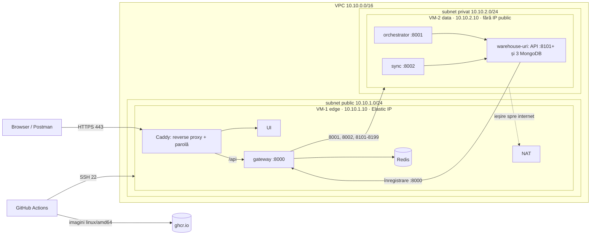

# Laborator 4 — Aplicația în nori (AWS)

Sistemul din [laboratorul 3](../laborator3/README.md) (proxy / Data Warehouse) mutat pe **2 instanțe EC2**
(`eu-north-1`, Stockholm), cu infrastructura descrisă în **Terraform** și livrare prin **GitHub Actions**.
Arhitectura aplicației (gateway, warehouse-uri, sync, cache) este descrisă în README-ul laboratorului 3.

## Diagrama



| Security group | Intrare permisă |
|---|---|
| `edge` | 80, 443 de oriunde; 22 de la `ssh_source_cidrs`; 8000 doar de la `data` |
| `data` | 22, 8001, 8002, 8101–8199 **doar de la `edge`** |

- Gateway-ul nu are autentificare, de aceea singura intrare publică spre aplicație este **Caddy cu parolă**
  (excepție: `/healthz`).
- MongoDB nu are parolă și **nu publică niciun port** în cloud.
- VM-2 iese în internet prin **NAT pe VM-1** (un NAT Gateway gestionat ar costa pe oră chiar și cu totul oprit).
- HTTPS: certificat Let's Encrypt pentru `<ip>.sslip.io` (nume DNS gratuit, serviciu terț) sau pentru domeniul tău
  (`domain_name`). Dacă certificatul nu se emite: `enable_https = false` (atunci parola circulă necriptată).

## Deploy

### 1. Unelte și acces AWS (o singură dată)

```bash
brew install awscli
brew tap hashicorp/tap && brew install hashicorp/tap/terraform
```

În consola AWS: **IAM → Users → Create user** `pad-terraform` (fără acces la consolă) → *Attach policies directly* →
`AmazonEC2FullAccess` → după creare, **Security credentials → Create access key** (*Command Line Interface*).

```bash
aws configure                  # access key, secret, regiune eu-north-1, output json
aws sts get-caller-identity    # trebuie să apară userul pad-terraform
aws ec2 describe-instance-types --filters Name=free-tier-eligible,Values=true \
    --query 'InstanceTypes[].InstanceType' --output text      # tipurile eligibile Free Tier

ssh-keygen -t ed25519 -f ~/.ssh/pad_lab4            # cheia ta
ssh-keygen -t ed25519 -f ~/.ssh/pad_lab4_ci -N ''   # cheia pipeline-ului
```

Cheile AWS și cheile SSH private nu se pun niciodată în repository.

Regiunea: planul inițial era `eu-central-1`, dar pe acest cont un *service control policy* al organizației AWS o
refuză (`UnauthorizedOperation ... explicit deny`). `eu-north-1` este permisă.

### 2. Infrastructura

```bash
cd laborator4/terraform
cp terraform.tfvars.example terraform.tfvars   # pune conținutul celor două fișiere .pub
terraform init
terraform plan -out=pad.tfplan
terraform apply pad.tfplan
terraform output                               # url, edge_public_ip
```

La primul boot, cloud-init instalează Docker, swap, NAT-ul și oprirea automată (câteva minute).
Verificare: `ssh -i ~/.ssh/pad_lab4 ubuntu@<ip> cloud-init status --wait`.

### 3. Configurarea GitHub (repository → Settings)

| Unde | Nume | Valoare |
|---|---|---|
| Secrets → Actions | `SSH_PRIVATE_KEY` | conținutul `~/.ssh/pad_lab4_ci` |
| Secrets → Actions | `SSH_KNOWN_HOSTS` | rezultatul comenzilor de mai jos |
| Secrets → Actions | `ADMIN_PASSWORD` | parola aplicației (minim 12 caractere) |
| Variables → Actions | `EDGE_HOST` | `terraform output -raw edge_public_ip` |
| Variables → Actions | `SITE_URL` | `terraform output -raw url` |
| Variables → Actions | `DEPLOY_ENABLED` | `true` |
| Variables → Actions | `ADMIN_USER` | opțional, implicit `admin` |

```bash
IP=$(terraform output -raw edge_public_ip)
ssh-keyscan -t ed25519 $IP
ssh -i ~/.ssh/pad_lab4 ubuntu@$IP ssh-keyscan -t ed25519 10.10.2.10
```

**Aprobare manuală (Continuous Delivery):** *Environments → production → Required reviewers*. Opțiunea poate lipsi
la un repository privat; atunci controlul manual este variabila `DEPLOY_ENABLED` împreună cu *Run workflow*.
**Blocarea PR-urilor:** *Branches → regulă pentru `main` → Require status checks* (testele și build-ul).

### 4. Livrarea

Pipeline-ul [lab4-ci-cd.yml](../.github/workflows/lab4-ci-cd.yml):

| Când | Ce face |
|---|---|
| orice push (orice ramură care conține workflow-ul), orice PR spre `main` | teste unitare, verificare Terraform și scripturi, build `linux/amd64`, teste de integrare |
| push / merge pe `main` | toate cele de mai sus + publică imaginile în GHCR + deploy și verificare |

Instanțele trebuie să fie **pornite** în momentul deploy-ului. După configurare: *Actions → lab4 CI/CD → Run workflow* pe `main`.

Deploy manual (aceleași scripturi; `GHCR_TOKEN` = token GitHub cu `read:packages`):

```bash
cd laborator4
read -rs "ADMIN_PASSWORD?Parola aplicatiei: " && export ADMIN_PASSWORD     # zsh
EDGE_HOST=<ip> SSH_KEY=~/.ssh/pad_lab4 IMAGE_PREFIX=ghcr.io/<owner-lowercase>/pad-lab4 TAG=<sha-commit> \
  GHCR_USER=<user> GHCR_TOKEN=<token> ./deploy/deploy.sh
BASE_URL=<url> ./deploy/verify.sh
```

La o versiune nouă, orchestratorul înlocuiește containerele API vechi; bazele de date și datele rămân.

## Pornire și oprire

```bash
./deploy/vm.sh stop      # oprește ambele instanțe (din laborator4/)
./deploy/vm.sh start     # pornește edge, apoi data; containerele au politica de repornire automată
./deploy/vm.sh status
terraform -chdir=terraform destroy     # șterge TOATE resursele (și datele): costurile se opresc complet
```

Ambele instanțe se opresc singure zilnic la **23:00** (`auto_stop_time`).

## Mărimea instanțelor și costul (eu-north-1, USD, prețuri on-demand la 26.11.2026)

| Mod | VM-1 + VM-2 | Warehouse-uri | 4 h/zi (120 h/lună) | 24/7 |
|---|---|---|---|---|
| economic (implicit) | `t3.micro` + `t3.small` — 0,032 /h | 1 (2 merg doar cu swap) | **≈ 10,9 /lună** | ≈ 30,6 /lună |
| prezentare | `t3.micro` + `c7i-flex.large` — 0,102 /h | 2–3 | ≈ 19,2 /lună | ≈ 81,1 /lună |

În sume intră costurile fixe de **≈ 7,0 /lună**, plătite și cu instanțele oprite: Elastic IP (3,65) și 2 × 20 GB disc gp3 (3,34).
Nu intră eventualul surplus de credit CPU la `t3` (`cpu_credits`). Schimbarea `data_instance_type` + `terraform apply`
repornește instanța și păstrează discul. Planul Free AWS se închide după 6 luni sau la epuizarea creditului,
iar accesul la resurse se pierde.

Un warehouse nou se adaugă din UI. `INITIAL_WAREHOUSES` (implicit 1) contează doar când nu există niciunul.

**Load Balancer:** nu este inclus. Un ALB ar costa ≈ 25 /lună fix (0,024 /h + 2 adrese IPv4 publice) plus trafic,
și cu instanțele oprite.

## Teste și rulare locală

```bash
for s in gateway dw-node orchestrator sync; do (cd $s && mvn -B verify); done   # JDK 21
(cd ui && npm ci && npm test)

docker compose up -d --build       # totul pe laptop: UI :3000, gateway :8000
./scripts/smoke-test.sh --chaos    # teste de integrare
./scripts/down.sh
```

`deploy/test-topology.sh` verifică cele două compose-uri de cloud pe o singură mașină (rulează în pipeline).

Containerele warehouse (`wh-1-…`) au aceleași nume ca în laboratorul 3: înainte de rularea locală, cele vechi trebuie
șterse (`../laborator3/scripts/down.sh` — **șterge și datele din laboratorul 3**).

Postman: [postman/lab4.postman_collection.json](postman/lab4.postman_collection.json); în cloud `gateway` = `<url>/api`,
plus variabilele `user` și `password`.

## Limitări

- Un singur VM edge și un singur gateway: dacă pică, aplicația nu mai e accesibilă.
- Starea Terraform este locală (`terraform.tfstate`): se păstrează pe calculatorul de pe care s-a făcut `apply`.
- Modificările din `cloud-init.yaml.tftpl` se aplică doar unei instanțe noi (`terraform apply -replace=aws_instance.edge`).
